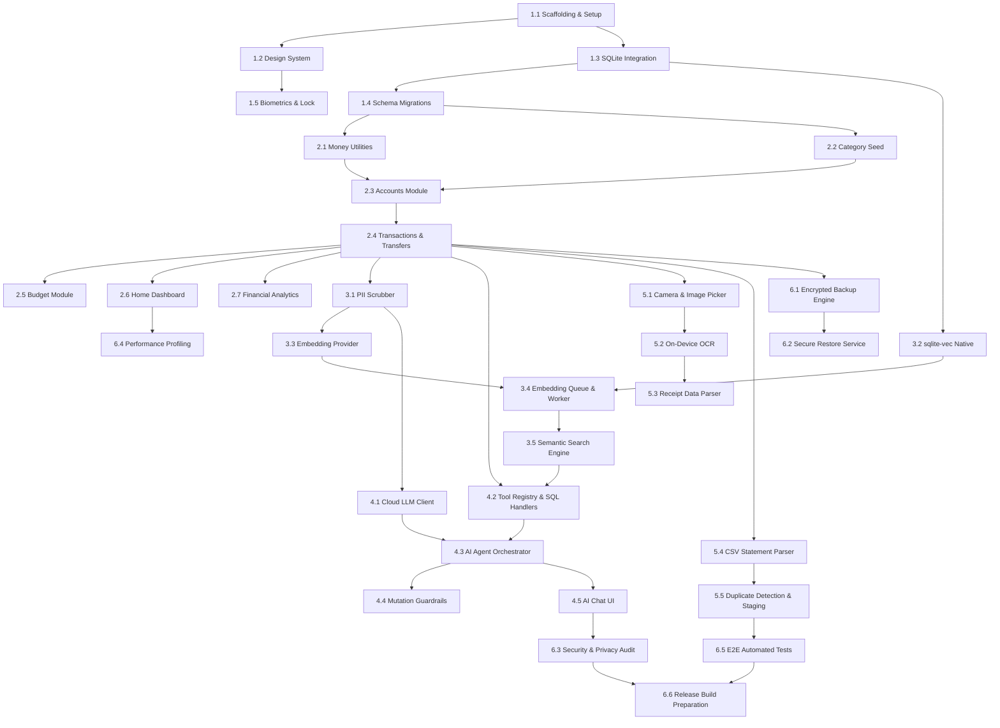

# SmartMoney — Phase Instructions & Development Task Breakdown

**Project:** SmartMoney (Your Private AI Finance Companion)  
**Target Platform:** iOS & Android (Expo / React Native / TypeScript)  
**Storage Architecture:** Local-First SQLite (`@op-engineering/op-sqlite`) + Vector Store (`sqlite-vec`)  
**AI Architecture:** Cloud LLM + Local Deterministic SQL Tools + Local RAG (Privacy-Preserving)  
**Reference Document:** [Product Requirements Document (PRD)](file:///home/aminul/development/Prod/finance/prd.md)  
**Currency Standard:** INR (₹) — Minor units (paise) represented as integer cents (`amount_minor = 145000` for ₹1,450.00). Floating-point currency arithmetic is strictly prohibited.

---

## 1. Architectural Invariants & Global Execution Instructions

All development teams and automated agents must adhere to the following non-negotiable rules across all phases:

1. **Local-First Financial Truth:**
   - SQLite is the single source of truth for all balances, transactions, accounts, and budgets.
   - Balances must never be stored as an unverified standalone scalar without a verifiable ledger trail.
   - Multi-table operations (transfers, deletions, account adjustments) must always execute inside explicit atomic SQLite transactions (`BEGIN TRANSACTION` ... `COMMIT`).
2. **Deterministic Calculations over AI Hallucinations:**
   - Financial summaries, totals, cashflow comparisons, and category rollups are calculated purely by local deterministic SQL queries.
   - The LLM will *never* perform manual arithmetic on raw records; it only reasons over and explains outputs returned by verified local tools.
3. **Zero Arbitrary Execution & Least Privilege:**
   - The LLM has zero direct SQL execution rights. No raw query input (`SELECT ...`) may ever be accepted from model output.
   - All tools are strict, parameterized, read-only prepared statements allowlisted in code.
   - Mutations (creating/updating/deleting transactions) requested by the AI must go through an explicit user UI confirmation step.
4. **Privacy Shield & Scrubbing Invariant:**
   - No raw notes, identifiable merchant names containing phone/UPI IDs, account numbers, or Indian PAN/Aadhaar patterns may be sent over the wire to external AI APIs without passing through the local PII scrubber.
   - Embeddings and AI requests use only `scrubbed_note`.
5. **Offline Reliability:**
   - Every financial operation (viewing dashboard, logging transactions, managing accounts, budgeting, analytics) must function 100% offline. Network is solely required for cloud AI completions and external embedding calls.

---

## 2. Phase Roadmap Overview

```
Phase 1: Foundation, DB Architecture & Security
  │
  ├──► Phase 2: Core Financial Ledger & Offline UI
  │      │
  │      └──► Phase 3: Privacy Shield & Vector RAG Pipeline
  │             │
  │             └──► Phase 4: AI Finance Agent & Tool Registry
  │                    │
  │                    └──► Phase 5: Receipt Scanner & Statement Import
  │                           │
  │                           └──► Phase 6: Encrypted Backup, Hardening & Release
```

| Phase | Milestone Name | Primary Focus | Output Deliverables |
|---|---|---|---|
| **Phase 1** | Foundation & Security | Core runtime, SQLite engine, migrations, biometrics | Functional app shell, encrypted key store, verified SQLite DB |
| **Phase 2** | Core Ledger & Offline UI | Accounts, transactions, transfers, budgets, analytics | Complete offline personal finance manager (8 core screens) |
| **Phase 3** | Privacy Shield & Local RAG | PII scrubber, sqlite-vec integration, embedding queue | Semantic search engine, zero-leakage local vector indexing |
| **Phase 4** | AI Finance Agent | Cloud LLM integration, tool registry, chat interface | Conversational finance assistant with verified SQL tools |
| **Phase 5** | Smart Import & Extraction | Receipt OCR & CSV statement parsing engine | Camera scanner, CSV mapper, duplicate detector, review UI |
| **Phase 6** | Backup, Hardening & Release | AES-256 backup, E2E testing, store readiness | Encrypted export/import, performance benchmarks, release build |

---

# Phase 1: Foundation, Database Architecture & Security Setup

### Phase Instructions
- Initialize a clean, modular Expo project using TypeScript in strict mode.
- Establish the native SQLite integration using `@op-engineering/op-sqlite`.
- Set up the database migration runner with atomic version tracking.
- Implement platform-native biometric authentication (`expo-local-authentication`) backed by hardware-backed key storage (`expo-secure-store`).
- Establish UI theme tokens (colors, typography, spacing, dark mode support).

### Entry Criteria
- Development environment configured with Node.js LTS, React Native / Expo toolchain, Android SDK / Xcode.
- PRD approved and architecture specifications reviewed.

### Exit Criteria
- App launches cleanly on both iOS and Android.
- SQLite database initializes, applies schema migrations version 1, and verifies read/write integrity.
- App locks automatically on backgrounding and unlocks via FaceID / Fingerprint / Device PIN.
- Database persists across app kill/restart cycles.

---

## Phase 1 Development Task Breakdown

### TASK-1.1: Project Scaffolding & Toolchain Configuration
- **Description:** Initialize Expo project with TypeScript, strict linting, and formatting rules.
- **Scope:** `package.json`, `tsconfig.json`, `.eslintrc.js`, `.prettierrc`, `app.json`
- **Dependencies:** None
- **Implementation Steps:**
  1. Initialize Expo project with blank TypeScript template.
  2. Configure `tsconfig.json` with `"strict": true`, `"noImplicitAny": true`, path aliases (`@/components`, `@/db`, `@/hooks`, `@/services`, `@/theme`).
  3. Install styling & navigation dependencies: `@react-navigation/native`, `@react-navigation/bottom-tabs`, `@react-navigation/native-stack`, `react-native-screens`, `react-native-safe-area-context`.
  4. Setup Lucide icons (`lucide-react-native`) and SVG support.
- **Acceptance Criteria:**
  - Project builds and runs on iOS Simulator and Android Emulator without warnings.
  - Path aliases resolve properly during compilation.

### TASK-1.2: Design System & Theming Foundation
- **Description:** Implement design tokens, typography, color palette, and layout primitives.
- **Scope:** `src/theme/colors.ts`, `src/theme/typography.ts`, `src/theme/spacing.ts`, `src/theme/ThemeProvider.tsx`
- **Dependencies:** TASK-1.1
- **Implementation Steps:**
  1. Define theme colors matching PRD: Backgrounds, Cards, Borders, Primary Green (`#10B981` / Emerald), Income Green, Expense Coral/Red (`#EF4444`), Transfer Blue (`#3B82F6`), Text Primary/Secondary/Muted.
  2. Implement system font scaling and typographic hierarchy (H1, H2, H3, Body, Caption, Monospace/Tabular numbers for currency).
  3. Create theme context provider supporting Light, Dark, and System preference.
  4. Build reusable primitives: `ScreenWrapper`, `Card`, `Button`, `Input`, `Badge`, `Header`.
- **Acceptance Criteria:**
  - Theme switching works seamlessly without visual layout jumps.
  - Text scales properly according to device accessibility settings.

### TASK-1.3: Native SQLite Integration & Database Helper
- **Description:** Integrate `@op-engineering/op-sqlite` and create a robust native database client.
- **Scope:** `src/db/client.ts`, `src/db/types.ts`
- **Dependencies:** TASK-1.1
- **Implementation Steps:**
  1. Install and link `@op-engineering/op-sqlite`.
  2. Configure database name `smartmoney.db` with WAL mode enabled (`PRAGMA journal_mode = WAL;`) and synchronous normal (`PRAGMA synchronous = NORMAL;`).
  3. Enforce foreign key constraints (`PRAGMA foreign_keys = ON;`).
  4. Write generic query helpers: `executeSql(query, params)`, `transaction(callback)`, and type-safe single/batch execution.
- **Acceptance Criteria:**
  - Database opens in sub-50ms on cold start.
  - Foreign key violations throw immediate errors.
  - Transaction rollbacks correctly undo mutations on failure.

### TASK-1.4: Database Schema Migrations Engine
- **Description:** Build an incremental migration runner that executes versioned schema scripts.
- **Scope:** `src/db/migrations/`, `src/db/migrationRunner.ts`, `src/db/migrations/001_initial_schema.sql`
- **Dependencies:** TASK-1.3
- **Implementation Steps:**
  1. Create `schema_migrations` table (`version INTEGER PRIMARY KEY, applied_at TEXT`).
  2. Implement `001_initial_schema.sql` defining:
     - `accounts` (`id`, `name`, `type`, `initial_balance`, `currency`, `is_archived`, `created_at`, `updated_at`)
     - `categories` (`id`, `name`, `type`, `icon`, `color`, `is_default`, `is_archived`)
     - `transactions` (`id`, `account_id`, `amount_minor`, `type`, `category_id`, `merchant`, `transaction_date`, `raw_note`, `scrubbed_note`, `needs_embedding`, `created_at`, `updated_at`)
     - `transfers` (`id`, `from_account_id`, `to_account_id`, `amount_minor`, `transfer_date`, `note`)
     - `budgets` (`id`, `category_id`, `monthly_limit_minor`, `alert_threshold`, `start_month`, `created_at`)
     - `receipts` (`id`, `transaction_id`, `file_path`, `mime_type`, `created_at`)
     - `embedding_jobs` (`id`, `transaction_id`, `status`, `retry_count`, `last_error`, `created_at`, `updated_at`)
     - `ai_conversations` & `ai_messages`
     - `user_settings` (`key`, `value`, `updated_at`)
  3. Add composite indexes on `transactions(transaction_date)`, `transactions(category_id)`, `transactions(account_id)`, and `budgets(category_id, start_month)`.
  4. Write migration runner verifying pending migrations and applying them inside an atomic transaction.
- **Acceptance Criteria:**
  - Fresh install runs migration to target version.
  - Re-running migration runner on up-to-date DB is a fast no-op.
  - Database schema matches PRD specifications exactly.

### TASK-1.5: Hardware-Backed Security & Biometric Lock Service
- **Description:** Implement biometric authentication and app-lock lifecycle manager.
- **Scope:** `src/security/biometrics.ts`, `src/security/secureStore.ts`, `src/security/AppLockProvider.tsx`, `src/screens/AuthLockScreen.tsx`
- **Dependencies:** TASK-1.2
- **Implementation Steps:**
  1. Integrate `expo-local-authentication` and `expo-secure-store`.
  2. Store security preferences (biometric enabled flag, auto-lock timeout duration: immediately, 1m, 5m, 15m) in `expo-secure-store`.
  3. Hook into `AppState` changes (`active` -> `background` / `inactive`). Track timestamp of backgrounding.
  4. If background duration exceeds threshold, trigger `AppLockScreen` overlay.
  5. Provide fallback device passcode prompt if biometric fails or is canceled.
- **Acceptance Criteria:**
  - App displays lock overlay immediately upon expiration of lock timeout.
  - Biometric authentication successfully dismisses overlay and restores session state.
  - Sensitive financial screens never leak in task switcher previews.

---

# Phase 2: Core Financial Ledger & Offline UI

### Phase Instructions
- Implement full offline ledger capabilities: Accounts, Categories, Transactions, Transfers, and Budgets.
- Strictly adhere to integer minor units (`amount_minor` as paise). Never store or calculate floating decimals.
- Build pure, optimized SQL queries for balance computation, cashflow, and budget utilization.
- Create responsive, polished UI screens based on the PRD specification (Dashboard, Accounts, Transaction List, Transaction Form, Budget Tracker, Analytics).

### Entry Criteria
- Phase 1 completed, verified, and tagged.
- SQLite database tables initialized and accessible via repositories.

### Exit Criteria
- Complete CRUD operations for accounts, categories, transactions, and budgets.
- Account transfers update balances correctly without double counting income or expenses.
- Dashboard cards (Total Balance, Monthly Income/Expense, Recent Transactions, Budget Progress) update in real-time.
- All ledger actions work 100% offline with zero network connectivity.

---

## Phase 2 Development Task Breakdown

### TASK-2.1: Money Utility & Formatters
- **Description:** Create bulletproof integer money manipulation and localized currency formatting utilities.
- **Scope:** `src/utils/money.ts`, `src/utils/money.test.ts`
- **Dependencies:** TASK-1.1
- **Implementation Steps:**
  1. Implement `formatCurrency(amountMinor: number, currency = 'INR'): string` (e.g. `145000` -> `₹1,450.00`).
  2. Implement `parseCurrencyInput(input: string): number` converting user input strings into minor integer units.
  3. Implement mathematical operations: `addMoney`, `subtractMoney`, `calculatePercentage`, `calculateProgressMinor`.
  4. Write exhaustive unit tests covering edge cases (zero, negative, high values, Indian number formatting 1,00,000).
- **Acceptance Criteria:**
  - Zero rounding or floating point precision errors.
  - Unit test suite passes with 100% branch coverage.

### TASK-2.2: Category Repository & Default Seed Data
- **Description:** Implement category data layer and initial default category seeds.
- **Scope:** `src/db/repositories/categoryRepository.ts`, `src/db/seeds/defaultCategories.ts`
- **Dependencies:** TASK-1.4
- **Implementation Steps:**
  1. Define default expense categories (Food & Dining, Groceries, Shopping, Transportation, Bills & Utilities, Entertainment, Health & Fitness, Travel, Education, Personal Care, General).
  2. Define default income categories (Salary, Freelance, Investment, Gift, Refund, Other Income).
  3. Implement repository methods: `getAllCategories()`, `getCategoriesByType(type)`, `createCategory()`, `updateCategory()`, `archiveCategory()`.
  4. Seed default categories upon initial database creation.
- **Acceptance Criteria:**
  - Default categories populate on initial launch.
  - Custom categories can be created with user-chosen icons and colors.

### TASK-2.3: Accounts Management Module
- **Description:** Account repository, account balance derivation, and Accounts UI screen.
- **Scope:** `src/db/repositories/accountRepository.ts`, `src/screens/accounts/`, `src/components/accounts/AccountCard.tsx`
- **Dependencies:** TASK-2.1, TASK-2.2
- **Implementation Steps:**
  1. Write SQL query calculating dynamic account balance:
     ```sql
     initial_balance + 
     (SELECT COALESCE(SUM(amount_minor), 0) FROM transactions WHERE account_id = a.id AND type = 'income') - 
     (SELECT COALESCE(SUM(amount_minor), 0) FROM transactions WHERE account_id = a.id AND type = 'expense') + 
     (SELECT COALESCE(SUM(amount_minor), 0) FROM transfers WHERE to_account_id = a.id) - 
     (SELECT COALESCE(SUM(amount_minor), 0) FROM transfers WHERE from_account_id = a.id)
     ```
  2. Implement `createAccount`, `updateAccount`, `archiveAccount`, `getAccountWithStats`.
  3. Build Account List screen with account type badges (Bank, Cash, Credit Card, Investment, Wallet).
  4. Build Add/Edit Account modal with initial balance and currency selector.
- **Acceptance Criteria:**
  - Balance updates instantly when transactions or transfers are recorded.
  - Archived accounts are hidden from active pickers but retain ledger integrity.

### TASK-2.4: Transaction Management & Transfer Engine
- **Description:** Transaction CRUD, transfer ledger logic, and transaction entry forms.
- **Scope:** `src/db/repositories/transactionRepository.ts`, `src/db/repositories/transferRepository.ts`, `src/screens/transactions/`
- **Dependencies:** TASK-2.3
- **Implementation Steps:**
  1. Build `addTransaction`, `updateTransaction`, `deleteTransaction` repository functions.
  2. Mark `needs_embedding = 1` and enqueue embedding job whenever a transaction is inserted or updated.
  3. Implement `createTransfer` running inside an explicit database transaction validating distinct source and destination accounts.
  4. Create intuitive Quick Add Transaction bottom sheet:
     - Amount keypad with instant preview.
     - Type toggle: Expense / Income / Transfer.
     - Account picker, Category selector with icons, Date/time picker, Merchant field, and Notes.
  5. Build Transaction History screen with search, category filtering, date-range picker, and monthly grouping.
- **Acceptance Criteria:**
  - Transfers decrease source account and increase target account without modifying total income or expenses.
  - Transactions list supports smooth infinite scrolling (virtualized list) with monthly summary headers.

### TASK-2.5: Budget Management Module
- **Description:** Monthly budget limits, category spending tracking, and alert calculation.
- **Scope:** `src/db/repositories/budgetRepository.ts`, `src/screens/budgets/`
- **Dependencies:** TASK-2.4
- **Implementation Steps:**
  1. Implement budget query computing monthly spend vs limit:
     ```sql
     SELECT b.*, c.name, c.icon, c.color,
            COALESCE(SUM(t.amount_minor), 0) as spent_minor
     FROM budgets b
     JOIN categories c ON b.category_id = c.id
     LEFT JOIN transactions t ON t.category_id = b.category_id 
          AND t.type = 'expense'
          AND strftime('%Y-%m', t.transaction_date) = b.start_month
     GROUP BY b.id;
     ```
  2. Calculate utilization percentage and alert flags (Safe < 80%, Warning 80-99%, Exceeded >= 100%).
  3. Create Budget List UI screen with visual progress bars and category breakdown.
  4. Build Create/Edit Budget modal with category selection, monthly limit, and alert threshold.
- **Acceptance Criteria:**
  - Budgets accurately calculate spent amounts for the selected month.
  - Exceeded budgets visually reflect warning colors and percentage badges.

### TASK-2.6: Home Dashboard Screen
- **Description:** Build the central command dashboard integrating all core ledger data.
- **Scope:** `src/screens/dashboard/DashboardScreen.tsx`, `src/components/dashboard/`
- **Dependencies:** TASK-2.3, TASK-2.4, TASK-2.5
- **Implementation Steps:**
  1. Build Total Balance Hero Card with visibility toggle (hide balance values with asterisks `••••••`).
  2. Implement Monthly Cashflow summary card (Total Income, Total Expense, Net Savings).
  3. Implement Quick Action bar (Add Expense, Add Income, Transfer, AI Chat).
  4. Embed Recent Transactions widget (last 5 transactions with "View All" link).
  5. Embed Top Budget Utilization progress bars.
  6. Add pull-to-refresh to re-query ledger summaries.
- **Acceptance Criteria:**
  - Cold load of dashboard renders in under 150ms.
  - Privacy toggle obscures sensitive financial balances across the dashboard.

### TASK-2.7: Financial Analytics & Visualizations
- **Description:** Implement category distribution charts, cashflow bar trends, and spending summaries.
- **Scope:** `src/screens/analytics/AnalyticsScreen.tsx`, `src/components/analytics/`
- **Dependencies:** TASK-2.4
- **Implementation Steps:**
  1. Query monthly category totals ordered by highest spend.
  2. Query 6-month historical cashflow trend (income vs expense by month).
  3. Implement donut/pie chart for category breakdown with interactive category legends.
  4. Implement monthly cashflow bar chart comparing income vs expense.
  5. Include Top Merchants list for the selected timeframe.
- **Acceptance Criteria:**
  - Charts render cleanly with smooth transitions and formatted currency tooltips.
  - All totals on analytics screen match exact database SQL aggregate sums.

---

# Phase 3: Privacy Shield & Vector RAG Pipeline

### Phase Instructions
- Build the local Privacy Shield to scrub Personally Identifiable Information (PII) before any external API or embedding call.
- Integrate `sqlite-vec` extension for on-device vector storage and similarity search.
- Implement an offline-resilient asynchronous embedding queue with retry logic.
- Ensure embeddings are generated solely from `scrubbed_note` and sanitized metadata.

### Entry Criteria
- Phase 2 completed with functional transactions table and sample transaction data.
- Native build environment configured to link `sqlite-vec` library.

### Exit Criteria
- PII scrubber removes/masks phone numbers, emails, credit/debit card numbers, UPI IDs, PAN, and Aadhaar numbers.
- `sqlite-vec` virtual table operates smoothly inside `@op-engineering/op-sqlite`.
- Background embedding worker processes `embedding_jobs` table when online and pauses gracefully when offline.
- Semantic search returns relevant transactions based on natural language queries.

---

## Phase 3 Development Task Breakdown

### TASK-3.1: Local PII Scrubber Engine
- **Description:** Build high-performance regex and pattern-based PII scrubber for notes and merchants.
- **Scope:** `src/security/piiScrubber.ts`, `src/security/piiScrubber.test.ts`
- **Dependencies:** None
- **Implementation Steps:**
  1. Implement regex patterns for:
     - Phone numbers: Indian (+91, 10-digit formats).
     - UPI IDs: `<name>@<bank>` (e.g. `user@okhdfcbank`, `9876543210@paytm`).
     - Email addresses: Standard RFC email formats.
     - Card numbers: 16-digit card formats with Luhn pre-check.
     - Indian PAN numbers: `[A-Z]{5}[0-9]{4}[A-Z]{1}`.
     - Indian Aadhaar numbers: 12-digit format `\b\d{4}\s?\d{4}\s?\d{4}\b`.
     - Sensitive keywords: passwords, OTPs, PINs.
  2. Implement `scrubText(input: string): { scrubbedText: string, hasRedactions: boolean }`.
  3. Replace matches with tokens: `[PHONE]`, `[UPI_ID]`, `[EMAIL]`, `[CARD_NUMBER]`, `[GOVT_ID]`.
  4. Write extensive test suite with real-world Indian transaction descriptions and edge cases.
- **Acceptance Criteria:**
  - 100% detection and masking rate on test corpus of Indian payment strings.
  - Scrubber operates synchronously in < 2ms per transaction string.

### TASK-3.2: sqlite-vec Native Integration & Vector Table Setup
- **Description:** Compile, link, and initialize `sqlite-vec` extension with SQLite client.
- **Scope:** `src/db/vector/vectorClient.ts`, `src/db/migrations/002_vector_tables.sql`
- **Dependencies:** TASK-1.3
- **Implementation Steps:**
  1. Configure `sqlite-vec` C-extension loading in `@op-engineering/op-sqlite`.
  2. Create virtual vector table:
     ```sql
     CREATE VIRTUAL TABLE vec_transactions USING vec0(
       transaction_id TEXT PRIMARY KEY,
       embedding float[1536] distance_metric=cosine
     );
     ```
  3. Create wrapper helpers: `insertVector(transactionId, floatArray)`, `deleteVector(transactionId)`, `searchKNN(vector, k)`.
- **Acceptance Criteria:**
  - sqlite-vec loads without crash on both iOS and Android.
  - Can store test 1536-dimensional vectors and perform cosine distance query in < 15ms.

### TASK-3.3: Embedding Provider Interface & Model Adapters
- **Description:** Create pluggable embedding provider interface supporting local or cloud embedding models.
- **Scope:** `src/ai/embeddings/types.ts`, `src/ai/embeddings/embeddingProvider.ts`
- **Dependencies:** TASK-3.1
- **Implementation Steps:**
  1. Define `EmbeddingProvider` interface (`generateEmbedding(text: string): Promise<number[]>`).
  2. Implement cloud embedding adapter (OpenAI `text-embedding-3-small` / Gemini embedding API).
  3. Implement text preparation formatter: combine sanitized merchant, category, and `scrubbed_note`.
  4. Validate dimension compatibility with `vec_transactions` schema.
- **Acceptance Criteria:**
  - Generates normalized unit vectors of expected dimensions.
  - Throws clean, recoverable network errors when offline.

### TASK-3.4: Offline-Resilient Embedding Queue & Worker
- **Description:** Implement background queue processing transactions marked for embedding generation.
- **Scope:** `src/services/embeddingQueueWorker.ts`, `src/db/repositories/embeddingJobRepository.ts`
- **Dependencies:** TASK-3.2, TASK-3.3
- **Implementation Steps:**
  1. Monitor network state with `@react-native-community/netinfo`.
  2. Write queue poller: queries pending rows from `embedding_jobs` (`status = 'pending'`, `retry_count < 5`).
  3. Process in batches (e.g. 10 items):
     - Fetch transaction details and `scrubbed_note`.
     - Generate embedding vector.
     - Insert/replace into `vec_transactions`.
     - Update job status to `'completed'` and set `transactions.needs_embedding = 0`.
  4. Implement exponential backoff for failed jobs (`status = 'failed'`, increment `retry_count`).
  5. Invalidate existing vector when a transaction is edited or deleted.
- **Acceptance Criteria:**
  - Adding transactions while offline does not block or error.
  - Automatically resumes and processes backlog when device re-establishes internet connection.

### TASK-3.5: Local Semantic Search Engine
- **Description:** Implement end-to-end semantic transaction retrieval merging vector search with SQL metadata.
- **Scope:** `src/services/semanticSearchService.ts`
- **Dependencies:** TASK-3.2, TASK-3.4
- **Implementation Steps:**
  1. Accept user natural language search query (e.g. "dinner with college friends", "trip flight tickets").
  2. Generate query embedding vector.
  3. Query `vec_transactions` for top $K$ nearest neighbors by cosine similarity.
  4. Join matched `transaction_id`s with `transactions`, `categories`, and `accounts` tables to retrieve full transaction entities.
  5. Filter by similarity threshold to exclude irrelevant matches.
- **Acceptance Criteria:**
  - Returns relevant transactions even when search query keywords do not match exact merchant name.
  - Returns results in under 200ms when connected.

---

# Phase 4: AI Finance Agent & Tool Registry

### Phase Instructions
- Integrate cloud LLM completions through a secure, controlled tool-calling protocol.
- Build the local Tool Registry containing strictly read-only, parameterized SQL queries.
- Implement conversational chat interface supporting streamed text and interactive tool visualization cards.
- Implement strict Guardrails: Financial mutations (e.g. creating/deleting a transaction via AI) require explicit user button confirmation before executing.

### Entry Criteria
- Phase 2 (Ledger) and Phase 3 (PII Scrubber & RAG) completed.
- AI API keys configured securely in environment or user settings.

### Exit Criteria
- User can chat with SmartMoney agent and receive accurate answers about their financial records.
- Agent calls appropriate tools (`get_category_totals`, `get_cashflow_trend`, `check_budget_status`, etc.) rather than fabricating numbers.
- Mutation intents generate a pending confirmation action card in chat.
- Zero raw SQL executed by the agent.

---

## Phase 4 Development Task Breakdown

### TASK-4.1: Cloud LLM Client & Secure Configuration
- **Description:** Implement streaming AI client with API key management and privacy header controls.
- **Scope:** `src/ai/llm/llmClient.ts`, `src/ai/llm/types.ts`
- **Dependencies:** TASK-1.5, TASK-3.1
- **Implementation Steps:**
  1. Support OpenAI / Gemini / Anthropic structured tool calling APIs.
  2. Securely store and retrieve user API key from `expo-secure-store`.
  3. Construct system prompt enforcing SmartMoney persona:
     - "You are SmartMoney, a private financial assistant."
     - "Always use provided tools to check factual financial balances and spending."
     - "Never invent financial numbers. Monetary units are in INR (₹)."
     - "Explain results concisely and highlight actionable insights."
  4. Enforce strict timeout and abort controller handling.
- **Acceptance Criteria:**
  - Client handles structured tool call requests and responses reliably.
  - Network disconnection displays user-friendly retry message.

### TASK-4.2: Local Tool Registry & SQL Tool Handlers
- **Description:** Implement deterministic, parameterized tool handlers that execute pre-compiled SQL queries.
- **Scope:** `src/ai/tools/toolRegistry.ts`, `src/ai/tools/definitions/`
- **Dependencies:** TASK-2.4, TASK-2.5, TASK-3.5
- **Implementation Steps:**
  1. Define JSON schema definitions and local execution handlers for:
     - `get_category_totals(start_date, end_date, category?)`
     - `get_cashflow_trend(months, start_date?, end_date?)`
     - `check_budget_status(category?)`
     - `search_transactions(query, start_date?, end_date?, limit)`
     - `semantic_search_transactions(query_text, limit)`
     - `get_account_summary(account_id?)`
     - `get_top_merchants(start_date, end_date, limit)`
  2. Implement strict input validation on all tool arguments (regex date formats `YYYY-MM-DD`, integer limits).
  3. Execute queries using prepared statements.
  4. Format returned results into compact JSON summaries for LLM consumption.
- **Acceptance Criteria:**
  - Only registered tool names can execute.
  - All financial aggregations in tool responses match manual SQL calculations exactly.

### TASK-4.3: AI Agent Orchestrator & Multi-Turn Loop
- **Description:** Coordinate conversation flow, tool execution loop, and message history persistence.
- **Scope:** `src/ai/agent/agentOrchestrator.ts`, `src/db/repositories/conversationRepository.ts`
- **Dependencies:** TASK-4.1, TASK-4.2
- **Implementation Steps:**
  1. Save messages in `ai_conversations` and `ai_messages` tables.
  2. Agent Execution Loop:
     - User submits question -> Scrub text -> Append to conversation history.
     - Send history + Tool definitions to LLM.
     - If LLM returns `tool_calls`:
       - Execute local tool handler with arguments.
       - Append tool result message to conversation.
       - Re-prompt LLM with tool output.
     - Final LLM text response streamed back to UI.
  3. Limit maximum tool execution depth to 3 turns to prevent infinite loops.
- **Acceptance Criteria:**
  - Agent answers multi-step questions (e.g. "Did I spend more on dining in October or November?").
  - History persists across app restarts.

### TASK-4.4: Mutation Guardrail & Confirmation Cards
- **Description:** Implement pending confirmation protocol for any AI-suggested financial mutation.
- **Scope:** `src/ai/agent/mutationGuardrail.ts`, `src/components/chat/ConfirmationCard.tsx`
- **Dependencies:** TASK-4.3
- **Implementation Steps:**
  1. Define mutation tool schemas: `propose_add_transaction`, `propose_delete_transaction`.
  2. When agent invokes a mutation tool, do NOT execute directly in database.
  3. Instead, intercept the request and construct a pending `ActionProposal` payload.
  4. Render interactive confirmation card in chat with "Confirm" and "Cancel" buttons.
  5. Only upon explicit user tap on "Confirm", invoke the real ledger repository method and notify chat.
- **Acceptance Criteria:**
  - No database write can ever occur solely from an LLM response without user interaction.
  - Tapping "Cancel" dismisses proposal without modifying database records.

### TASK-4.5: AI Chat Interface Screen
- **Description:** Build fluid conversational interface with markdown support, tool visualization cards, and voice/quick prompts.
- **Scope:** `src/screens/chat/ChatScreen.tsx`, `src/components/chat/`
- **Dependencies:** TASK-4.3, TASK-4.4
- **Implementation Steps:**
  1. Build message bubble components with Markdown rendering (`react-native-markdown-display`).
  2. Add suggested prompt chips ("This month's expenses", "Budget check", "Top 5 merchants").
  3. Render specialized visual cards for tool outputs (Category spending breakdown card, Cashflow mini-chart).
  4. Add loading skeleton and typing indicator during tool execution and streaming.
  5. Include clear conversation history / reset button.
- **Acceptance Criteria:**
  - Smooth 60fps scrolling with keyboard avoidance (`KeyboardAvoidingView`).
  - Markdown tables, lists, and bold text render cleanly with theme styling.

---

# Phase 5: Receipt Scanner & Statement Import

### Phase Instructions
- Build the physical receipt scanning workflow using on-device camera/gallery and OCR.
- Implement structured transaction extraction from raw OCR text with fallback to LLM parser.
- Build the CSV bank statement import engine with column mapping and duplicate transaction detection.
- Provide a mandatory visual Review & Confirmation screen before committing imported records to the ledger.

### Entry Criteria
- Phase 2 (Core Ledger) and Phase 4 (AI/Extraction tools) completed.
- Camera and file system permissions configured in `app.json`.

### Exit Criteria
- User can photograph a receipt and review auto-filled amount, date, merchant, and category.
- User can import a CSV statement, map headers, preview detected rows, and skip duplicates.
- All accepted imports write to SQLite atomically without ledger corruption.

---

## Phase 5 Development Task Breakdown

### TASK-5.1: Camera & Document Picker Integration
- **Description:** Implement camera capture and image picker services for receipt scanning.
- **Scope:** `src/services/cameraService.ts`, `src/screens/receipts/ReceiptCaptureModal.tsx`
- **Dependencies:** TASK-1.1
- **Implementation Steps:**
  1. Configure `expo-camera` and `expo-image-picker`.
  2. Handle camera/photo library permission requests with graceful fallback explanations.
  3. Implement camera capture UI with receipt alignment overlay rectangle and flashlight toggle.
  4. Save captured/selected image to local app storage directory (`receipts/`).
  5. Store image path and link to `receipts` table.
- **Acceptance Criteria:**
  - High-resolution receipt image captured and saved locally.
  - Images are kept strictly on-device.

### TASK-5.2: On-Device OCR Processing
- **Description:** Extract raw text lines and bounding boxes from receipt images using on-device ML Kit / Tesseract.
- **Scope:** `src/services/ocrService.ts`
- **Dependencies:** TASK-5.1
- **Implementation Steps:**
  1. Integrate native on-device text recognition library (e.g. `@react-native-ml-kit/text-recognition` or Expo OCR module).
  2. Pre-process image (greyscale / contrast normalization if needed).
  3. Run text recognition and return extracted text blocks and lines.
  4. Benchmark execution time and ensure UI displays an animated processing spinner.
- **Acceptance Criteria:**
  - Extracts text from typical printed store receipts in < 1.5 seconds on device.
  - Operates 100% offline without uploading image to any external cloud service.

### TASK-5.3: Receipt Data Extraction & Parser
- **Description:** Parse raw OCR text to extract total amount, transaction date, merchant name, and suggested category.
- **Scope:** `src/services/receiptParser.ts`
- **Dependencies:** TASK-5.2, TASK-3.1
- **Implementation Steps:**
  1. Rule-based extraction (Regex matcher for totals: `Total`, `Grand Total`, `Amount Due`, `Net Amount` followed by currency numbers).
  2. Date pattern parser (DD/MM/YYYY, DD-MMM-YYYY, ISO dates).
  3. Merchant candidate detection from top lines of receipt.
  4. Fallback parser: When online and regex confidence is low, scrub OCR text and prompt LLM with structured output schema (`amount_minor`, `date`, `merchant`, `category_hint`).
  5. Return structured candidate object to review screen.
- **Acceptance Criteria:**
  - Accurately parses standard retail/grocery bills.
  - Gracefully falls back to manual entry fields if OCR text is unreadable or blurry.

### TASK-5.4: CSV Bank Statement Parser & Column Mapper
- **Description:** Implement CSV file parsing, header auto-detection, and flexible column mapping.
- **Scope:** `src/services/csvImportService.ts`, `src/screens/import/CsvMappingModal.tsx`
- **Dependencies:** TASK-2.1
- **Implementation Steps:**
  1. Integrate lightweight CSV parser (e.g. `papaparse`).
  2. Read CSV file via `expo-document-picker` and `expo-file-system`.
  3. Implement column autodetection algorithm for common Indian bank formats (HDFC, ICICI, SBI, Axis):
     - Date columns (`Date`, `Txn Date`, `Value Date`)
     - Description / Narration columns (`Narration`, `Description`, `Particulars`)
     - Debit / Credit or unified Amount columns with Type indicator
  4. Build interactive Column Mapping screen allowing user to review and correct detected columns.
- **Acceptance Criteria:**
  - Successfully parses 5,000+ row CSV statement in under 2 seconds.
  - Allows manual column assignment if bank statement format is non-standard.

### TASK-5.5: Duplicate Detection & Transaction Staging
- **Description:** Implement duplicate detection algorithm to prevent double-counting imported transactions.
- **Scope:** `src/services/duplicateDetection.ts`, `src/screens/import/ImportReviewScreen.tsx`
- **Dependencies:** TASK-5.4, TASK-2.4
- **Implementation Steps:**
  1. Implement duplicate heuristic score:
     - Match exact `account_id`, `amount_minor`, and `transaction_date`.
     - Fuzzy match on merchant/description string similarity (Levenshtein distance).
  2. Flag potential duplicates in the import staging list.
  3. Build Import Review Screen:
     - Batch transaction table with checkboxes.
     - Highlight existing vs new items.
     - Editable category and merchant fields for each row.
     - "Select All", "Deselect Duplicates", and "Import X Transactions" buttons.
  4. Commit selected records in a single atomic database batch transaction.
- **Acceptance Criteria:**
  - Existing transactions are flagged as duplicates and unchecked by default.
  - Batch commit of 500 transactions executes in < 300ms without freezing the UI.

---

# Phase 6: Encrypted Backup, Hardening & Production Release

### Phase Instructions
- Implement full encrypted backup and restore using standard cryptography (AES-256-GCM + PBKDF2).
- Perform comprehensive security audit, network traffic inspection, and performance profiling.
- Execute unit, integration, and end-to-end automated testing suites.
- Prepare production build configurations, app icons, splash screens, and store release metadata.

### Entry Criteria
- All functional modules (Phases 1-5) fully implemented and integrated.
- Core user flows operational on test devices.

### Exit Criteria
- Complete encrypted backup file can be exported, shared, and restored onto another device with password validation.
- Zero PII leaks detected during network packet analysis.
- Cold start time < 800ms; frame rate maintains stable 60fps during scrolling.
- Production `.ipa` and `.aab` packages build cleanly without errors.

---

## Phase 6 Development Task Breakdown

### TASK-6.1: Encrypted Backup Engine
- **Description:** Export complete local SQLite database, settings, and receipt files into an encrypted archive.
- **Scope:** `src/services/backup/backupService.ts`, `src/services/backup/crypto.ts`
- **Dependencies:** TASK-1.3, TASK-1.4
- **Implementation Steps:**
  1. Request user-provided master backup password (minimum 8 characters, strength check).
  2. Derive 256-bit encryption key using PBKDF2 with 100,000+ iterations and cryptographic salt.
  3. Export database snapshot into JSON or binary SQLite archive.
  4. Encrypt payload using AES-256-GCM (producing ciphertext, IV, and auth tag).
  5. Package archive metadata (version, timestamp, salt, IV, auth tag, payload).
  6. Trigger native share sheet (`expo-sharing`) allowing user to save file to iCloud Drive, Google Drive, or local storage.
- **Acceptance Criteria:**
  - Backup file contains complete relational database state.
  - Backup file cannot be read or decrypted without the exact password.

### TASK-6.2: Secure Restore & Integrity Verification
- **Description:** Import, decrypt, validate, and restore database from backup file.
- **Scope:** `src/services/backup/restoreService.ts`, `src/screens/settings/BackupRestoreScreen.tsx`
- **Dependencies:** TASK-6.1
- **Implementation Steps:**
  1. Select backup file using `expo-document-picker`.
  2. Prompt user for backup password.
  3. Verify salt, IV, and attempt decryption with derived key.
  4. If auth tag verification fails, throw immediate "Incorrect password or corrupted file" error.
  5. Validate decrypted database schema and integrity (`PRAGMA integrity_check`).
  6. Present restore options: "Replace All Data" or "Merge Data".
  7. Apply restored database within atomic transaction and reload active application state.
- **Acceptance Criteria:**
  - Incorrect password immediately rejected without corrupting active database.
  - Restored database passes SQLite integrity check and restores exact account balances.

### TASK-6.3: Security & Privacy Audit
- **Description:** Comprehensive vulnerability assessment and network telemetry verification.
- **Scope:** Global codebase, network layer, logging configurations
- **Dependencies:** TASK-3.1, TASK-4.1
- **Implementation Steps:**
  1. Inspect network traffic using MITM proxy (Charles / Proxyman / Wireshark).
  2. Verify that no raw account numbers, phone numbers, or unscrubbed notes are transmitted.
  3. Verify that all external requests are made over HTTPS/TLS 1.3.
  4. Audit app logs: strip all `console.log` statements in production builds (`babel-plugin-transform-remove-console`).
  5. Verify that SQLite database files in app sandbox are excluded from unencrypted OS backups.
- **Acceptance Criteria:**
  - Zero sensitive financial data or PII in cleartext over network or in device system logs.

### TASK-6.4: Performance Optimization & Profiling
- **Description:** Profile and optimize startup time, query execution times, memory usage, and list virtualization.
- **Scope:** `src/db/`, `src/components/`, `src/screens/`
- **Dependencies:** TASK-2.4, TASK-2.6
- **Implementation Steps:**
  1. Profile SQLite queries: verify all transaction and budget queries use indexes (`EXPLAIN QUERY PLAN`).
  2. Optimize FlashList / FlatList components with `getItemLayout` and `memo` to avoid re-renders.
  3. Lazy load heavy components and screens (AI chat, analytics charts, receipt scanner).
  4. Profile memory consumption during large CSV imports and vector search.
- **Acceptance Criteria:**
  - Cold launch time to interactive dashboard under 800ms on mid-tier Android devices.
  - Transaction list maintains consistent 60fps scrolling performance with 10,000+ records.

### TASK-6.5: End-to-End Automated Testing & Quality Assurance
- **Description:** Implement automated test suites covering critical financial user journeys.
- **Scope:** `e2e/`, `src/**/*.test.ts`
- **Dependencies:** All previous tasks
- **Implementation Steps:**
  1. Implement unit test suites for all repositories, math formatters, and PII scrubber.
  2. Implement Maestro / Detox E2E tests for:
     - Onboarding -> Account creation -> Add Expense -> Verify Dashboard balance.
     - Add Income -> Create Category Budget -> Verify Progress bar.
     - Transfer between Bank and Cash -> Verify both accounts updated.
     - Offline mode switch -> Add transaction -> App restart -> Verify data preserved.
     - Export encrypted backup -> Clear data -> Restore backup -> Verify balances.
- **Acceptance Criteria:**
  - 100% pass rate on CI/CD regression test suite.

### TASK-6.6: Production Build & App Store Readiness
- **Description:** Finalize production app configuration, assets, permissions, and build pipelines.
- **Scope:** `app.json`, `assets/`, `eas.json`
- **Dependencies:** TASK-6.5
- **Implementation Steps:**
  1. Generate all required application icons, adaptive icons, and splash screens.
  2. Configure `app.json` with appropriate permissions descriptions (Camera, Face ID, Photo Library).
  3. Configure EAS Build profiles (`eas.json`) for iOS TestFlight and Android Google Play Internal App Sharing.
  4. Verify production bundle size and tree-shaking optimizations.
  5. Produce release builds (`.aab` and `.ipa`).
- **Acceptance Criteria:**
  - Production builds pass Apple App Store Connect and Google Play Console automated pre-launch checks.

---

## 3. Dependency Matrix & Critical Path



---

## 4. Definition of Done (DoD) Checklist per Task

Before any individual task or PR can be marked as complete:
- [ ] Code is written in strict TypeScript without `any` overrides.
- [ ] Monetary operations strictly use integer minor units (paise). No floating point arithmetic.
- [ ] Database mutations run inside SQLite transactions where multiple tables or rows are affected.
- [ ] Offline operation verified (all ledger, account, budget, and local search operations work with airplane mode on).
- [ ] Unit tests written and passing for all business logic, parsers, and utilities.
- [ ] PII scrubbing verified for any string sent to external services or embedding models.
- [ ] UI adheres to theme tokens, supports dark mode, and handles accessibility/font scaling.
- [ ] Zero unhandled promise rejections or native crashes.

